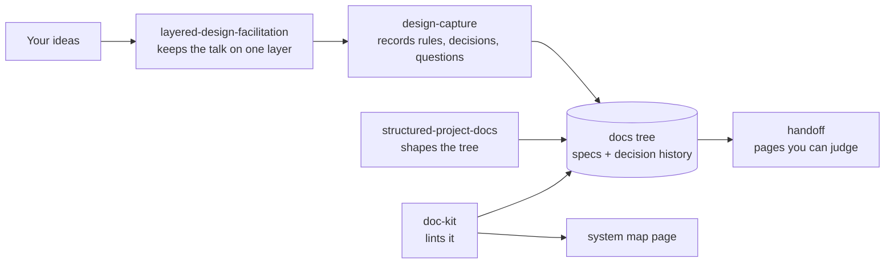

# creative-design

Five skills that take open-ended design work from a stream of loose ideas to a specification that stays consistent. They are written for people who know their subject and design with an AI assistant over many sessions: a game, a system architecture, a product concept, a set of requirements.

Status: **0.x pre-release**. The skills work together and are tested, but names and file formats may still change.

## What it does



| Skill | Use it to |
|---|---|
| [`layered-design-facilitation`](skills/layered-design-facilitation/SKILL.md) | Work through a design in layers (L0 vision to L4 implementation), top-down by default, with deliberate moves between layers: park, probe, ascend |
| [`design-capture`](skills/design-capture/SKILL.md) | Turn design talk into specs with stable rule IDs, a history of pivotal decisions and sized open questions; conflicts with recorded rules are quoted back before anything is written |
| [`structured-project-docs`](skills/structured-project-docs/SKILL.md) | Keep the docs a navigable tree of small single-topic files |
| [`doc-kit`](skills/doc-kit/SKILL.md) | Scaffold the tree and check it with `doclint`: front matter, links, IDs, retired names, numbers that come too early, coupling between systems. It also writes the interactive system map |
| [`handoff`](skills/handoff/SKILL.md) | Get an HTML page in place of a long report: an overview of finished work, a decision brief, an explainer |

The ideas behind them: rules that must always hold are checked by a script, not left to instructions; each fact has one owning file; systems depend on each other's interfaces, not on each other's rules.

## Install

**Claude Code** (the whole bundle as a plugin):

```
claude plugin marketplace add jonah-wodarz/creative-design
claude plugin install creative-design@creative-design
```

**Claude apps** (web, desktop): zip a skill folder (`cd skills && zip -r doc-kit.zip doc-kit`) and upload it in the skill settings. Repeat for each of the five.

**Other agents** that read `SKILL.md` folders: copy the folders in `skills/` to the agent's skills directory.

`doclint` and the page builder need Python 3.7 or later and nothing else.

## Quickstart

1. In an empty project folder, ask: *"Set up a design project for <your idea> with doc-kit."* You get the docs tree, the conventions file and the lint.
2. Start designing: *"Let's design this top-down."* The facilitation skill proposes layers and holds the talk on the current one.
3. Say what you decide. *"Record that."* The capture skill writes rules into the owning spec and asks before it overrides an earlier ruling.
4. Ask for the state at any time: *"Show me the system map"* or *"Give me an overview page of today's session."*

Skills load more reliably when the project names them. The conventions file from doc-kit contains a *Skills in use* table; point your project instructions at it.

A complete small project to look at: [`skills/doc-kit/examples/tidewatch`](skills/doc-kit/examples/tidewatch).

## Checks

```
python -m unittest discover -s skills/doc-kit/tests
python skills/handoff/scripts/build.py overview skills/handoff/assets/examples/overview.json --validate
python skills/handoff/scripts/sync_shared.py --check
```

## License

[MIT](LICENSE).
